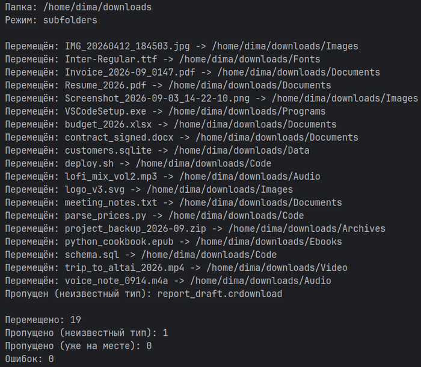

# File-sorter

[](https://github.com/Wlwool/File-sorter/actions/workflows/tests.yml)
[](https://www.python.org/downloads/)
[](https://github.com/astral-sh/uv)
[](#установка)

Сортировщик файлов по папкам для Linux и Windows: картинки к картинкам, музыка к музыке, документы к документам. Работает разово, следит за папкой в реальном времени или живёт в фоне как служба. Любую сортировку можно отменить.

---



---

## Возможности

- `clean`: разовая сортировка папки (например, захламлённого рабочего стола).
- `watch`: слежение за папкой, новые файлы сортируются сразу после появления.
- `service`: автозапуск слежения при входе в систему (systemd на Linux, Планировщик заданий на Windows).
- `undo`: возврат файлов последней сортировки на прежние места.
- Интерактивное меню: запуск `file-sorter` без аргументов в терминале.
- Три режима назначения: системные папки, подпапки рядом с файлами или любая своя папка.
- Свой конфиг категорий в формате TOML.

## Технологии

- Python 3.14: стандартная библиотека (`argparse`, `tomllib`, `pathlib`, `json`)
- [uv](https://docs.astral.sh/uv/): управление Python, зависимостями и запуском
- [watchdog](https://github.com/gorakhargosh/watchdog): слежение за папкой
- [platformdirs](https://github.com/tox-dev/platformdirs): системные папки пользователя, конфиг и журнал на Linux и Windows
- [pytest](https://docs.pytest.org/) и [Ruff](https://docs.astral.sh/ruff/): тесты, линтер и форматирование

## Установка

Нужен [uv](https://docs.astral.sh/uv/). Нужный Python (3.14 и новее) uv скачает сам.

Linux:

```bash
curl -LsSf https://astral.sh/uv/install.sh | sh
```

Windows (PowerShell):

```powershell
powershell -ExecutionPolicy ByPass -c "irm https://astral.sh/uv/install.ps1 | iex"
```

Скачать проект и запускать одной командой, окружение uv создаст при первом запуске:

```bash
git clone https://github.com/Wlwool/File-sorter.git
cd File-sorter
./run.sh --help
```

На Windows вместо `./run.sh` используйте `run.bat`. Двойной щелчок по `run.sh` или `run.bat` откроет интерактивное меню.

Чтобы команда `file-sorter` была доступна из любой папки (это обязательно для службы, см. ниже), установите программу как инструмент uv. В папке проекта:

```bash
uv tool install .
```

## Быстрый старт

Показать, что будет сделано, ничего не перемещая:

```bash
file-sorter clean ~/Desktop --mode subfolders --dry-run
```

Разобрать папку по-настоящему:

```bash
file-sorter clean ~/Desktop --mode subfolders
```

Передумали:

```bash
file-sorter undo
```

## Команды

Если папка не указана, берётся папка "Загрузки" пользователя.

### clean

Разовая сортировка файлов в папке (вложенные папки не трогаются). Файлы неизвестных типов остаются на месте. Если имя в папке назначения занято, файл получает счётчик: `a.jpg` становится `a_1.jpg`.

```bash
file-sorter clean [папка] [--mode MODE] [--target ПАПКА] [--dry-run] [--config ФАЙЛ]
```

Одна сортировка `clean` записывается в журнал как один запуск, и один `undo` возвращает её целиком.

### watch

Следит за папкой и сортирует файлы, которые в ней появляются. Файлы, лежавшие до запуска, не трогает (для них есть `clean`). Файл сортируется, когда он не менялся заданное число секунд, чтобы не забрать недокачанный. Остановка: Ctrl+C.

```bash
file-sorter watch [папка] [--mode MODE] [--target ПАПКА] [--dry-run] [--config ФАЙЛ] [--settle СЕКУНДЫ] [--log-file ФАЙЛ]
```

| Параметр | Что делает |
|---|---|
| `--settle` | сколько секунд файл не должен меняться (по умолчанию 2.5) |
| `--log-file` | писать весь вывод в файл, для работы в фоне |

### service

Фоновая служба выполняет `file-sorter watch` с выбранными параметрами и стартует при входе в систему.

```bash
file-sorter service install [папка] [--mode MODE] [--target ПАПКА] [--config ФАЙЛ] [--settle СЕКУНДЫ]
file-sorter service start
file-sorter service stop
file-sorter service status
file-sorter service uninstall
```

| Действие | Что делает |
|---|---|
| `install` | устанавливает службу и сразу запускает |
| `start` | запускает |
| `stop` | останавливает, автозапуск остаётся |
| `status` | показывает состояние |
| `uninstall` | останавливает и убирает автозапуск |

Служба запоминает путь к Python, из которого её установили. Поэтому ставить её нужно после `uv tool install .`, а не из запуска через `uv run` или `uvx`: окружение, которое исчезает после запуска, сломает службу.

Linux: служба оформлена как пользовательский unit `file-sorter.service` в `~/.config/systemd/user/`. Журнал: `journalctl --user -u file-sorter.service -f`. Чтобы служба запускалась при загрузке без входа в систему, один раз выполните `loginctl enable-linger`.

Windows: служба оформлена как задание "File-sorter" в Планировщике, запускается при входе пользователя без окна консоли. Вывод пишется в файл журнала, его путь показывают `service install` и `service status`.

### undo

Возвращает файлы последней сортировки на прежние места. Повторный запуск откатывает предыдущую сортировку, как Ctrl+Z.

```bash
file-sorter undo
```

Что делает `undo` с каждым файлом:

- файла нет на месте: пропускает и сообщает;
- файл изменился после сортировки (другой размер или время изменения): не трогает, пропускает и сообщает;
- исходной папки больше нет: создаёт её;
- исходное имя занято: возвращает под другим именем (`b.pdf` становится `b_1.pdf`) и сообщает об этом;
- ошибка на одном файле не останавливает остальные.

Пустые папки, которые создала сортировка, `undo` не удаляет.

Коды выхода: `0` без ошибок (пропуски ошибкой не считаются), `1` были ошибки, `2` журнал не читается.

**Внимание, служба.** Если служба следит за той же папкой, файлы, возвращённые `undo`, она увидит как новые и отсортирует снова. Перед `undo` остановите её: `file-sorter service stop`.

### Интерактивное меню

`file-sorter` без аргументов в терминале показывает меню: разобрать папку, показать что будет сделано, следить за папкой, управлять службой, отменить последнюю сортировку. Меню задаёт вопросы по шагам и запускает соответствующую команду.

## Куда раскладываются файлы

| Режим | Куда попадают файлы |
|---|---|
| `system` (по умолчанию) | в системные папки пользователя: Изображения, Музыка, Документы и т. д. |
| `subfolders` | в подпапки внутри сортируемой папки (`Загрузки/Images`) |
| `custom` | в подпапки внутри папки из `--target` (указание `--target` само включает этот режим) |

Категории встроенного конфига:

| Категория | Подпапка (subfolders, custom) | Системная папка (system) | Примеры расширений |
|---|---|---|---|
| image | Images | Изображения | jpg, png, gif, svg, webp, psd, raw |
| video | Video | Видео | mp4, mkv, avi, mov, webm |
| audio | Audio | Музыка | mp3, flac, wav, ogg, m4a |
| documents | Documents | Документы | pdf, docx, txt, xlsx, pptx, csv, md |
| archive | Archives | Документы/Archives | zip, rar, 7z, tar, gz, iso |
| code | Code | Документы/Code | py, js, java, cpp, html, css, sql, sh |
| executable | Programs | Загрузки/Programs | exe, msi, apk, jar, dll |
| ebooks | Ebooks | Документы/Ebooks | epub, mobi, fb2, djvu |
| data | Data | Документы/Data | sqlite, db, dat, log |
| fonts | Fonts | Документы/Fonts | ttf, otf, woff, woff2 |
| cad | CAD | Документы/CAD | dwg, dxf, step, stl, obj |

Полный список расширений лежит во встроенном конфиге `src/file_sorter/default_config.toml`.

## Свой конфиг

Свой конфиг полностью заменяет встроенный, поэтому проще всего скопировать `default_config.toml` и править копию. Файл ищется так:

1. путь из `--config`, если задан
2. `config.toml` в папке настроек пользователя (на Linux `~/.config/file-sorter/config.toml`)
3. встроенный конфиг

Пример своей категории:

```toml
[categories.pics]
folder = "Pics"
system_dir = "pictures"
extensions = ["jpg", "png"]
```

| Поле | Значение |
|---|---|
| `folder` | имя папки в режимах `subfolders` и `custom` |
| `system_dir` | системная папка для режима `system`: `documents`, `downloads`, `music`, `pictures`, `videos` |
| `system_subdir` | подпапка внутри системной папки (необязательно) |
| `extensions` | расширения без точки; одно расширение принадлежит только одной категории |

Пути `folder` и `system_subdir` должны быть простыми относительными: без `..` и без абсолютного пути.

## Журнал перемещений

Команда `undo` опирается на файл `journal.jsonl` в папке состояния пользователя:

- Linux: `~/.local/state/file-sorter/journal.jsonl`
- Windows: папка состояния приложения в `AppData\Local\file-sorter`

В журнал попадают только настоящие перемещения, пробный запуск `--dry-run` ничего не пишет. Хранятся последние 50 запусков, более старые удаляются сами. Для `watch` один запуск журнала это пачка файлов, обработанная за один проход слежения.

## Разработка

```bash
uv sync
uv run pytest -q
uv run ruff check
uv run ruff format --check
```
